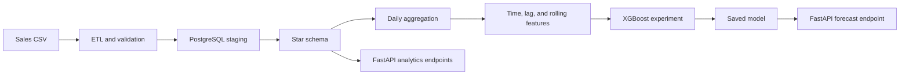

# Sales Intelligence Platform

A Python analytics prototype that turns transactional sales data into a PostgreSQL star schema, daily analytical features, an experimental XGBoost forecasting workflow, and FastAPI endpoints.

> **Evaluation status:** the current forecasting experiment includes same-day sales aggregates among the model inputs. Those fields are not available when forecasting a future day, so the existing R² and MAE values are not valid evidence of out-of-sample forecasting performance. The feature set must be corrected and the model retrained before headline metrics are published.

## What is implemented

- CSV extraction, cleaning, validation, and Parquet output
- PostgreSQL staging and a fact/dimension warehouse model
- Indexed fact table for analytical queries
- Daily time, lag, and rolling-window feature generation
- XGBoost training and saved model artifacts
- FastAPI endpoints for forecasts and warehouse summaries
- Stored analytical and model-evaluation figures

## Architecture



## Warehouse model

The project creates:

- `fact_sales`
- `dim_product`
- `dim_customer`
- `dim_location`
- `dim_date`

The API exposes aggregate revenue views by region and category alongside an overall summary.

## Repository structure

```text
api/                 FastAPI application and schemas
data/processed/      Cleaned and model-ready Parquet artifacts
models/              Saved XGBoost model
notebooks/           Exploratory analysis script
outputs/             Analytical and evaluation figures
src/etl.py           Extract, transform, validate, and load workflow
src/warehouse.py     PostgreSQL fact/dimension model
src/features.py      Daily feature generation
src/forecast.py      Training, evaluation, and recursive forecast code
config.py            Paths, database settings, and model parameters
requirements.txt     Python dependencies
```

## Local setup

Database connection settings are read from environment variables. Do not commit a real `.env` file.

Suggested local variables:

```dotenv
DB_HOST=localhost
DB_PORT=5432
DB_NAME=sales_db
DB_USER=sales_user
DB_PASSWORD=replace_with_a_local_password
```

Create a virtual environment and install the dependencies:

```bash
python -m venv .venv
source .venv/bin/activate
pip install -r requirements.txt
```

Place `Sample - Superstore.csv` in `data/raw/`, create the configured PostgreSQL database and user, then run:

```bash
python src/etl.py
python src/warehouse.py
python src/features.py
python src/forecast.py
```

## Run the API

```bash
uvicorn api.main:app --host 0.0.0.0 --port 8001
```

Open `http://localhost:8001/docs` for the interactive API documentation.

Implemented routes include:

- `GET /health`
- `POST /forecast`
- `GET /summary`
- `GET /revenue/by-region`
- `GET /revenue/by-category`

Example forecast request:

```bash
curl -X POST "http://localhost:8001/forecast" \
  -H "Content-Type: application/json" \
  -d '{"days": 30}'
```

## Work required before publishing forecast metrics

1. Remove same-day category revenue, region revenue, order count, quantity, and any other fields unavailable at prediction time.
2. Define a clear forecast origin and horizon.
3. Compare against seasonal-naive and rolling-average baselines.
4. Use walk-forward or expanding-window validation.
5. Report the evaluation period, sample size, MAE/RMSE, and uncertainty.
6. Verify that the recursive multi-step forecast uses only information available at each simulated future step.

## Limitations

- The current model evaluation contains target leakage and is not suitable for a performance claim.
- The repository does not currently contain a Tableau workbook or a live dashboard deployment.
- The `region` and `category` fields in the forecast request schema are not applied by the forecast implementation.
- Automated tests, continuous integration, deployment configuration, and production database migrations are not yet included.
- The included data and model artifacts should be checked for source attribution and redistribution rights before a release is published.
